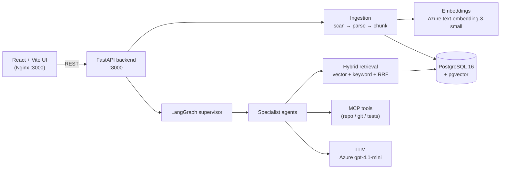

<div align="center">

# 🧠 RepoMind AI

**An agentic codebase copilot. Import a repository and ask questions about it in plain English. Every answer is grounded in the real source code and cites exact files and line numbers.**


</div>

---

## What it does

Point RepoMind at a public GitHub repository, or pick a folder on your computer. It reads the code, understands its structure, and lets you ask things like:

| Ask… | RepoMind… |
|---|---|
| *"Explain how a request flows from the upload page to the result"* | traces the components and data flow, citing each step |
| *"Where is the transcribe function defined?"* | returns the exact file and lines, e.g. `app.py:L18-31` |
| *"What would be affected if I change the embedding model?"* | follows the dependency graph to list affected files |
| *"Create an implementation plan to add user login"* | writes a step-by-step plan based on the existing code |
| *"Create a test plan for the upload endpoint"* | proposes unit, integration, API, edge, security and regression tests |
| *"Debug: the app errors when no file is uploaded"* | finds the likely root cause in the code and suggests a fix |
| *"Review the current code changes"* | reviews the working-tree diff with severity-labelled findings |

Every answer comes **only from retrieved code**. If the evidence isn't there, RepoMind says *"I could not find sufficient evidence"* instead of guessing.

---

## Highlights

- **Code-aware RAG:** Python files are parsed with the standard library's `ast` module, and TypeScript/JavaScript with a dedicated parser, to extract functions, classes, methods and imports. Code is split into symbol-aware chunks of about 512 tokens with overlap.
- **Hybrid retrieval:** pgvector cosine search combined with PostgreSQL full-text search and rank fusion.
- **Multi-agent orchestration:** a LangGraph supervisor classifies each question and routes it to a specialist agent. The agents are Codebase Analyst, Planner, Change Impact, Code Review, Test Plan, Debugging and Tool-Using.
- **Verified citations:** `[path:Lstart-Lend]` citations are built from stored chunk line ranges and checked against file hashes.
- **MCP server:** 10 tools (repo search, read, symbols, dependencies, git status/diff/log, tests, linter) exposed over the Model Context Protocol and reused in-process by the agents.
- **Safe by design:** no `shell=True`, command allowlists, timeouts, output caps, path-traversal checks, and secret files are never indexed. Repository content is treated as untrusted data, never as instructions.
- **Pluggable AI providers:** Azure AI Foundry (default) or local Ollama, behind one `LLMProvider` / `EmbeddingProvider` interface.
- **Fast indexing:** batched, concurrent embedding with a content-hash cache, and re-imports skip unchanged files. Progress shows files done, total and time left.
- **Measured quality:** `python -m evals.run` scores citation recall and term recall on a sample repository.

---

## Architecture



**Flow:** import → scan and hash files → parse symbols and imports → chunk → embed → store. Then for each question: classify intent → retrieve evidence → specialist agent → LLM answer → validated citations.

Details: [docs/ARCHITECTURE.md](docs/ARCHITECTURE.md) · Beginner guide to how everything works: **[docs/PROJECT_GUIDE.md](docs/PROJECT_GUIDE.md)**

---

## Tech stack

| Layer | Technology |
|---|---|
| Frontend | React 18, TypeScript, Vite, Tailwind CSS, TanStack Query, served by Nginx |
| Backend | Python 3.11, FastAPI, Pydantic, SQLAlchemy (async, asyncpg), Alembic, structlog |
| Database | PostgreSQL 16 + pgvector (768-dimension vectors), PostgreSQL full-text search |
| AI orchestration | LangGraph supervisor + specialist agents, Model Context Protocol (FastMCP) |
| AI models | Azure AI Foundry: `gpt-4.1-mini` (chat), `text-embedding-3-small` (embeddings). Optional local Ollama |
| Infrastructure | Docker Compose (postgres, backend, frontend) |
| Quality | pytest (174 tests), ESLint, ruff, evaluation runner |

---

## Quick start

### Prerequisites
- [Docker Desktop](https://www.docker.com/products/docker-desktop/)
- [Git](https://git-scm.com/)
- An Azure AI Foundry resource with a chat deployment (e.g. `gpt-4.1-mini`) and an embedding deployment (`text-embedding-3-small`). Setup steps are in [docs/PROJECT_GUIDE.md](docs/PROJECT_GUIDE.md#5-azure-ai-foundry-setup). To run fully offline you can use Ollama instead.

### 1. Clone
```bash
git clone https://github.com/Abdurrehman0815/repomind-ai.git
cd repomind-ai
```

### 2. Configure
```bash
cp .env.example .env        # Windows PowerShell: Copy-Item .env.example .env
```
Edit `.env` and set:
```ini
LLM_PROVIDER=azure_foundry
LLM_ENDPOINT=https://<your-resource>.services.ai.azure.com
LLM_API_KEY=<your key>
LLM_MODEL=gpt-4.1-mini
LLM_API_STYLE=openai

EMBEDDING_PROVIDER=azure_foundry
EMBEDDING_MODEL=text-embedding-3-small
EMBEDDING_DIMENSIONS=768
EMBEDDING_ENDPOINT=https://<your-resource>.openai.azure.com
RETRIEVAL_MIN_SIMILARITY=0.2
```
> `.env` is git-ignored. Never commit your key.

### 3. Run
```bash
docker compose up -d --build
docker compose exec backend alembic upgrade head   # first run only: create tables
```
Open **http://localhost:3000**. Go to **Projects**, then **Import Repository**, and enter a GitHub URL or choose a folder. When it shows **indexed**, ask questions in **Chat**.

| Service | URL |
|---|---|
| App | http://localhost:3000 |
| API docs (Swagger) | http://localhost:8000/docs |
| Health | http://localhost:8000/health/full |

---

## Development

```powershell
# Backend (from backend/)
python -m venv venv; .\venv\Scripts\Activate.ps1
pip install -r requirements.txt
pytest                                   # 147 unit tests

# MCP server tests (from mcp-server/)
..\backend\venv\Scripts\python.exe -m pytest   # 27 tests

# Frontend (from frontend/)
npm install
npm run build; npm run lint

# Grounding evaluation (stack running)
python -m evals.run
```

Lifecycle helper: `scripts/repomind.ps1 -Task setup|start|stop|test|lint|format|evaluate`

---

## Project structure

```
repomind-ai/
├── backend/            FastAPI app
│   ├── app/
│   │   ├── api/v1/       REST endpoints (projects, chat, health, symbols, retrieval)
│   │   ├── ingestion/    scanner, parsers, chunker, symbol extractor
│   │   ├── agents/       specialist agents + grounded answer helper
│   │   ├── services/     supervisor (LangGraph), retrieval, citations, memory
│   │   ├── ai/providers/ Azure Foundry, Ollama, embedding providers
│   │   ├── models/       SQLAlchemy models   repositories/  data access
│   │   └── security/     prompt-injection and path safety
│   ├── alembic/        database migrations
│   └── tests/          unit tests
├── frontend/           React app (Dashboard, Projects, Chat)
├── mcp-server/         FastMCP server: 10 repo/git/test tools + tests
├── evals/              grounding cases, sample repo, runner
├── scripts/            repomind.ps1, DB init
├── docs/               architecture, decisions, security, guide, status
└── docker-compose.yml
```

---

## Security

- The AI never gets a shell. Tools run from an allowlist with fixed arguments, timeouts and output caps.
- Secret files (`.env*`, `*.pem`, `*.key`, …) are never indexed or read by tools.
- Repository content is wrapped as untrusted data in prompts, and instructions found in code are ignored.
- RepoMind never edits your files. Fixes are proposed for you to apply.

More: [docs/SECURITY.md](docs/SECURITY.md)

---

## Documentation

| Doc | What's inside |
|---|---|
| [PROJECT_GUIDE.md](docs/PROJECT_GUIDE.md) | Simple explanation of every part, setup commands, Docker, moving to another laptop |
| [ARCHITECTURE.md](docs/ARCHITECTURE.md) | Components and data flow |
| [DECISIONS.md](docs/DECISIONS.md) | Why each technology was chosen (incl. Azure over Bedrock) |
| [SECURITY.md](docs/SECURITY.md) | Threat model and controls |
| [EVALUATION.md](docs/EVALUATION.md) | How answer quality is measured |
| [DEPLOYMENT.md](docs/DEPLOYMENT.md) | Environment variables and deployment |
| [IMPLEMENTATION_STATUS.md](docs/IMPLEMENTATION_STATUS.md) | Phase-by-phase build log (31 phases) |

---

<div align="center">
Built by <a href="https://github.com/Abdurrehman0815">Abdur Rehman</a>
</div>
