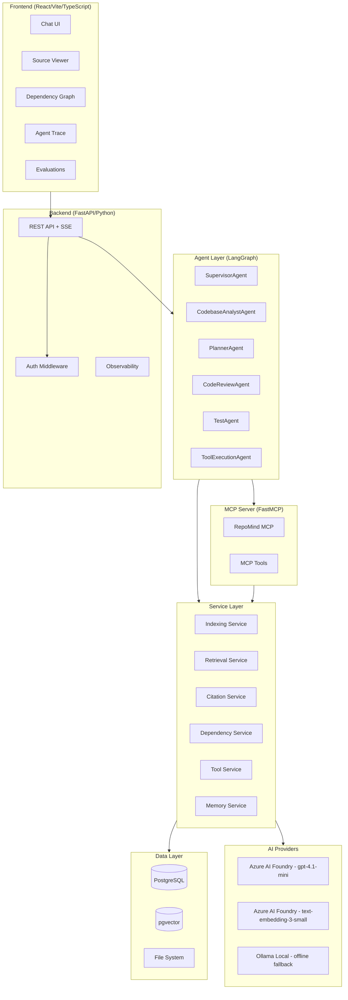
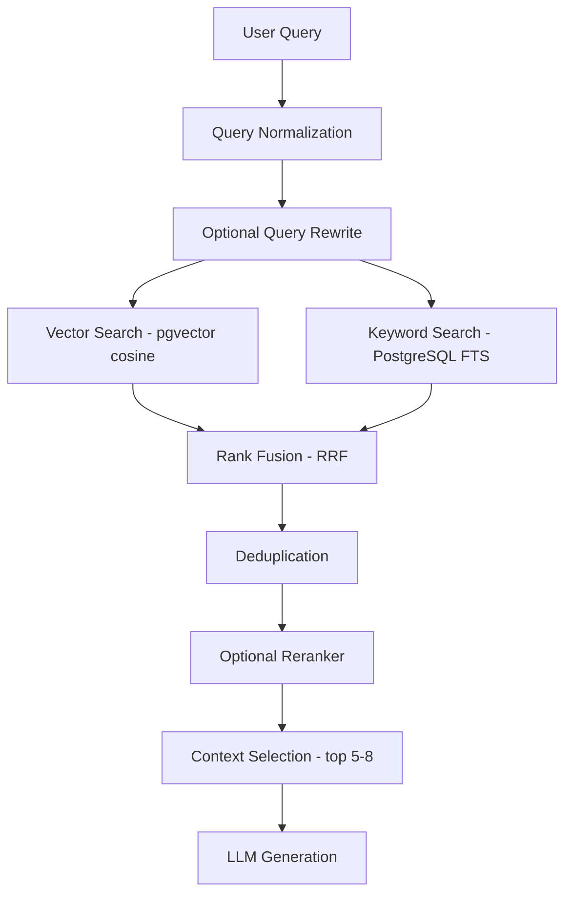
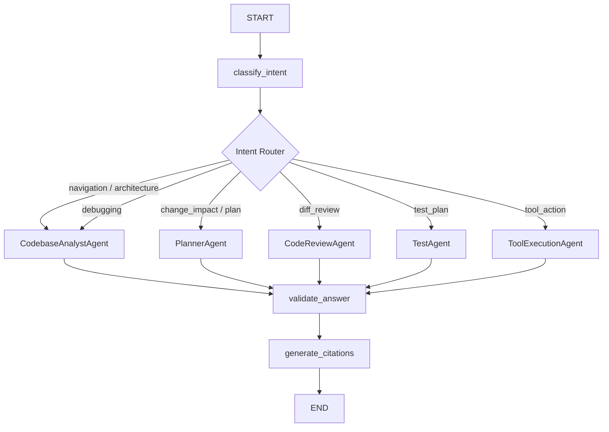
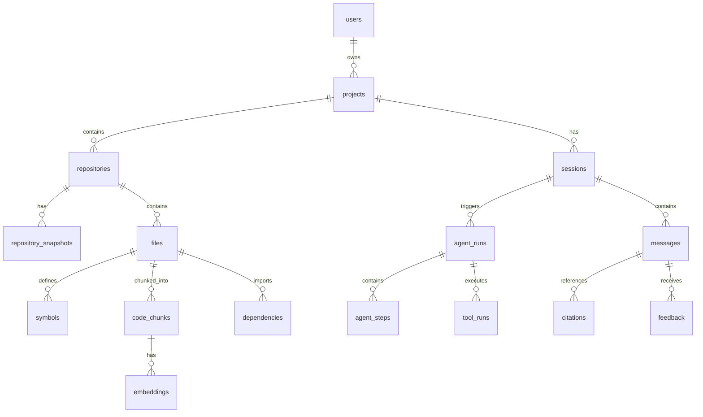

# RepoMind AI — Architecture

## Overview

RepoMind AI is built as a layered, modular system with clear separation between
the frontend, API gateway, agent layer, retrieval pipeline, and data stores.

---

## High-Level Architecture



---

## Repository Ingestion Pipeline


---

## Hybrid Retrieval Pipeline



---

## Agent Orchestration (LangGraph)



---

## Multi-Agent Responsibilities

| Agent | Responsibilities |
|---|---|
| SupervisorAgent | Intent classification, routing, final validation |
| CodebaseAnalystAgent | Code retrieval, symbol analysis, architecture explanation |
| PlannerAgent | Change impact, implementation planning |
| CodeReviewAgent | Diff parsing, finding generation, severity ranking |
| TestAgent | Test strategy, unit/integration/edge/security test plans |
| ToolExecutionAgent | Controlled tool invocation, result interpretation |

---

## Directory Structure

```
repomind-ai/
├── frontend/
│   ├── src/
│   │   ├── components/
│   │   ├── pages/
│   │   ├── hooks/
│   │   ├── services/
│   │   └── types/
│   ├── tests/
│   ├── index.html
│   ├── vite.config.ts
│   └── package.json
│
├── backend/
│   ├── app/
│   │   ├── api/           # FastAPI routers
│   │   ├── core/          # Config, startup, DI
│   │   ├── db/            # SQLAlchemy engine, session
│   │   ├── models/        # SQLAlchemy ORM models
│   │   ├── schemas/       # Pydantic request/response schemas
│   │   ├── services/      # Business logic
│   │   ├── repositories/  # Data access layer
│   │   ├── ingestion/     # File scanning, parsing, chunking
│   │   ├── retrieval/     # Hybrid search, reranking
│   │   ├── agents/        # LangGraph agents + nodes
│   │   ├── tools/         # Tool implementations
│   │   ├── security/      # Path validation, allowlists
│   │   ├── ai/
│   │   │   └── providers/ # LLMProvider abstraction
│   │   └── observability/ # Logging, tracing, metrics
│   ├── tests/
│   │   ├── unit/
│   │   ├── integration/
│   │   ├── e2e/
│   │   └── security/
│   ├── alembic/
│   ├── alembic.ini
│   └── requirements.txt
│
├── mcp-server/
│   ├── app/
│   │   ├── server.py
│   │   └── tools/
│   └── tests/
│
├── evals/
│   ├── datasets/
│   │   ├── qa_cases.jsonl
│   │   ├── retrieval_cases.jsonl
│   │   ├── tool_cases.jsonl
│   │   └── review_cases.jsonl
│   ├── runners/
│   └── reports/
│
├── docs/
├── scripts/
├── docker-compose.yml
├── .env.example
├── .gitignore
└── README.md
```

---

## Data Model Overview



---

## LLM Provider Abstraction

```
LLMProvider (abstract)
    ├── generate(prompt, options) → str
    ├── stream(prompt, options) → AsyncIterator[str]
    ├── structured_generate(prompt, schema, options) → BaseModel
    └── tool_calling(prompt, tools, options) → ToolCallResult

AzureFoundryProvider  (default: Azure AI Foundry, OpenAI or Anthropic wire format)
LocalOllamaProvider   (offline fallback)

EmbeddingProvider: AzureEmbeddingProvider | OllamaEmbeddingProvider | LocalEmbeddingProvider
```

The application code always calls `get_llm_provider()` — never Azure or Ollama directly.

---

## Security Architecture

See [SECURITY.md](SECURITY.md) for full details.

Key controls:
1. **Path isolation** — every repository access validates against project root
2. **Secret exclusion** — .env, *.key, *.pem excluded from indexing
3. **Prompt injection defense** — repository content never promoted to system instructions
4. **Tool allowlist** — only pre-approved commands can be executed
5. **Human-in-the-loop** — file modifications require explicit user approval

---

## Observability

Every request carries:

```
request_id → session_id → agent_run_id → node_name
```

LLM calls track:
- model provider + model name
- input/output tokens (when available)
- latency_ms
- estimated cost (zero for local, real for Azure)
